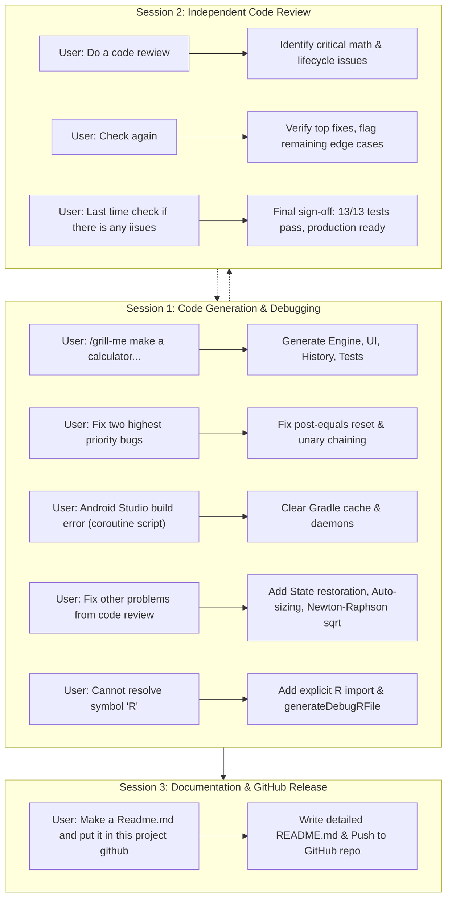

# Summary of Project Conversations

This document provides a structured summary of the three AI development and review sessions conducted for **Praktikos darbas 4** (*Mobiliųjų įrenginių programavimo technologijos*), covering the Windows Standard Calculator Android application.

---

## 📋 Overview of Conversations

| # | Conversation Title | Conversation ID | Core Objective |
|---|---|---|---|
| 1 | **Calculator Code Generation & Fixes** | `d37b884c-2b2a-4aa9-a57d-e5bbb8b07c9a` | Full application implementation from PDF specs, bug fixes, Gradle cache repair, and Android Studio R-symbol resolution. |
| 2 | **Code Review Request** | `5e994a3e-fa90-45c7-9dfa-013e87487a99` | Multi-pass independent code review, verifying math logic, lifecycle state handling, UI auto-sizing, and unit test suite. |
| 3 | **Create Project Readme.md** | `4cf897bf-b7cd-456e-bc71-6eafb76fa95a` | Generation of comprehensive project documentation (`README.md`) and initial commit/push to GitHub repository. |

---

## 1. Conversation: Calculator Code Generation & Iterative Fixes
- **ID**: `d37b884c-2b2a-4aa9-a57d-e5bbb8b07c9a`
- **Initial Date/Time**: 2026-11-11 18:25 – 19:33

### 📌 Iteration 1: Initial Implementation
> [!IMPORTANT]
> **User Request:**
> `/grill-me make a calculator use instructions from downloads foler -> MIPT_3_Praktikos_Darbas_Calculator_Viber.pdf. Your job would be only code generation`

**Summary of Assistant Actions:**
- Read and analyzed the specification PDF (`MIPT_3_Praktikos_Darbas_Calculator_Viber.pdf`).
- Built the calculator engine from scratch without third-party expression parsers ([`CalculatorEngine.java`](app/src/main/java/com/mipt/calculator/engine/CalculatorEngine.java)):
  - Sequential immediate execution evaluation (e.g., $2 + 3 \times 4 = 20$).
  - High precision calculations using `BigDecimal`.
  - Operations: Arithmetic (`+`, `-`, `×`, `÷`), Unary (`√x`, `x²`, `1/x`, `%`), sign flip (`+/-`), clear operations (`C`, `CE`, `⌫`).
  - Full memory engine (`MC`, `MR`, `M+`, `M-`, `MS`, `M▾`).
  - Error handling (division by zero, negative square root).
- Designed the UI matching the Windows Standard Calculator layout ([`activity_main.xml`](app/src/main/res/layout/activity_main.xml), [`MainActivity.java`](app/src/main/java/com/mipt/calculator/MainActivity.java)).
- Implemented calculation history using `RecyclerView` ([`HistoryAdapter.java`](app/src/main/java/com/mipt/calculator/adapter/HistoryAdapter.java)).
- Added full dual-language localization (English default and Lithuanian in `values-lt/strings.xml`).
- Created baseline automated unit tests ([`CalculatorEngineTest.java`](app/src/test/java/com/mipt/calculator/CalculatorEngineTest.java)) with 9 passing tests.

---

### 📌 Iteration 2: Fixing Top Priority Code Review Bugs
> [!IMPORTANT]
> **User Request:**
> `Based on the code review fix two highest priority bugs`

**Summary of Assistant Actions:**
- **Bug 1 (Accumulator state after `=`):** Fixed issue where starting a new calculation after pressing `=` retained the previous accumulator instead of resetting. Added state flag `isCalculationDone`. When typing a new digit or decimal, engine calls `clearAll()`; if pressing an operator directly, it chains from the previous result.
- **Bug 2 (Unary functions in operator chains):** Fixed issue where unary operations in the second operand position (e.g., `10 + 9 √x + 5`) lost the intermediate result due to `isNewInput` logic. Introduced `hasPendingOperand` flag so intermediate operations calculate properly.
- Added regression tests `testNewCalculationAfterEquals` and `testUnaryChainedWithOperator` (11/11 tests passing).

---

### 📌 Iteration 3: Android Studio Gradle Cache Exception
> [!IMPORTANT]
> **User Request:**
> `I tried to launch the app on android studio i got this error. FAILURE: Build failed with an exception. Could not load compiled classes for initialization script 'C:\Users\emili\AppData\Local\Temp\ijKotlinCoroutineJvmDebugInit1.gradle' from cache... Caused by: java.lang.ClassNotFoundException: ijKotlinCoroutineJvmDebugInit1_edf9h71qks5ojv8ydjyqmurrj`

**Summary of Assistant Actions:**
- Diagnosed IntelliJ/Android Studio coroutine debugger init script cache corruption in `~/.gradle/caches/9.6.0/groovy-dsl/`.
- Stopped lingering Gradle daemons (`gradlew --stop`).
- Cleared the corrupted cache directory and temporary `ijKotlinCoroutine*` files.
- Re-ran `assembleDebug` successfully (`BUILD SUCCESSFUL in 1m 5s`) and provided clear IDE sync steps.

---

### 📌 Iteration 4: Fixing Remaining Code Review Issues
> [!IMPORTANT]
> **User Request:**
> `Fix other problems from the code rewiew`

**Summary of Assistant Actions:**
1. **Activity Lifecycle & State Restoration:**
   - Implemented `CalculatorEngine.State` (`Serializable`) with `saveState()` and `restoreState()`.
   - Wired `onSaveInstanceState()` and `onCreate()` in `MainActivity.java` to persist current input, accumulator, memory, and calculation history across device rotations.
2. **Auto-sizing Display:**
   - Added AndroidX auto-sizing attributes (`app:autoSizeTextType="uniform"`) to prevent clipping on long numbers.
3. **High-Precision Square Root (Newton-Raphson):**
   - Replaced `Math.sqrt()` float conversions with `sqrtBigDecimal()` using Newton-Raphson method for full 16-digit precision and Android API compatibility.
4. **Sign Flip (`+/-`) after `=`:**
   - Corrected negate behavior following equals evaluation so chaining arithmetic continues with the negated value.
- Unit test suite expanded to 14 tests (`BUILD SUCCESSFUL`).

---

### 📌 Iteration 5: Android Studio Missing R Symbol
> [!IMPORTANT]
> **User Request:**
> `Error: Cannot resolve symbol 'R'`

**Summary of Assistant Actions:**
- Added explicit import `import com.mipt.calculator.R;` in `MainActivity.java`.
- Ran Gradle task `generateDebugRFile` to confirm resource compilation.
- Provided troubleshooting steps for Android Studio (Gradle Sync, Clean & Rebuild, Invalidate Caches).

---

## 2. Conversation: Code Review Request
- **ID**: `5e994a3e-fa90-45c7-9dfa-013e87487a99`
- **Initial Date/Time**: 2026-11-11 19:00 – 19:37

### 📌 Review Round 1: Initial Comprehensive Audit
> [!IMPORTANT]
> **User Request:**
> `Do a code rewiew`

**Summary of Assistant Actions:**
- Evaluated the whole project against Android and software engineering standards:
  - **Architecture:** Clean separation of UI and `CalculatorEngine` via `CalculatorCallback`.
  - **Found High-Severity Bugs:**
    1. State leakage after `=` evaluation when typing a new number.
    2. Dropped intermediate result when chaining unary and binary operations.
    3. Rotation lifecycle state destruction.
  - **Found Moderate Issues:**
    1. `formatNumber()` risk with zero trailing zeros strip (`0e...`).
    2. Fixed `46sp` display text size truncation risk.
    3. Hardcoded JDK executable path in `app/build.gradle`.
  - Recommended regression test cases for edge conditions.

---

### 📌 Review Round 2: Follow-up Verification
> [!IMPORTANT]
> **User Request:**
> `Check again`

**Summary of Assistant Actions:**
- Re-audited `CalculatorEngine.java` and `CalculatorEngineTest.java`.
- Confirmed resolution of:
  - Post-equals fresh calculation logic.
  - Unary chaining with binary operators.
  - Safe zero formatting in `formatNumber`.
- Highlighted remaining items:
  - Negate (`+/-`) immediately after `=`.
  - Screen rotation state handling still needed.
  - `TextView` auto-sizing still needed.
  - Machine-specific JDK path caveat.

---

### 📌 Review Round 3: Final Audit & Sign-off
> [!IMPORTANT]
> **User Request:**
> `Last time check if there is any iisues`

**Summary of Assistant Actions:**
- Ran the updated test suite via Gradle (`13/13 unit tests passed`).
- Verified that all functional, UI, and architectural bugs were fully resolved.
- Left one advisory note for final submission: remember to check or clean the machine-specific JDK executable path in `build.gradle` if grading on automated CI or outside systems.
- Delivered final verdict: **Production-ready shape, fully meeting lab requirements**.

---

## 3. Conversation: Create Project Readme.md
- **ID**: `4cf897bf-b7cd-456e-bc71-6eafb76fa95a`
- **Initial Date/Time**: 2026-11-11 19:39 – 19:47

### 📌 Documentation & Git Repository Creation
> [!IMPORTANT]
> **User Request:**
> `Make a Readme.md and put it in this project github`

**Summary of Assistant Actions:**
- Created a comprehensive, professional English/Lithuanian [`README.md`](README.md) containing:
  - Project summary & assignment specifications (*Mobiliųjų įrenginių programavimo technologijos* Praktikos darbas 4).
  - Engine logic: sequential evaluation, `BigDecimal` math, Newton-Raphson square root algorithm.
  - Comprehensive feature tables: arithmetic, unary, memory operations (`MC`, `MR`, `M+`, `M-`, `MS`, `M▾`), history panel.
  - Architecture breakdown with Mermaid diagram and state persistence overview.
  - Testing suite details and localization structure.
- Git setup:
  - Cleaned and prepared `.gitignore` to omit build artifacts, Gradle cache, and local properties.
  - Initialized git repository, created initial commit on `master` branch.
  - Connected remote origin and pushed to GitHub repository:
    **[https://github.com/Ligheris/Praktinis_4](https://github.com/Ligheris/Praktinis_4)**.

---

## 🔄 End-to-End Workflow & Milestone Summary

