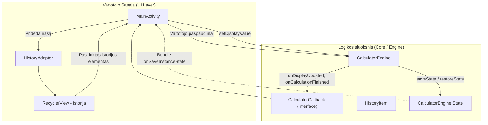

# Praktikos darbas Nr. 4: Standartinis Skaičiuotuvas (Standard Calculator)

Android mobilioji programėlė – pilnavertis „Windows Standard Calculator“ analogas su išplėstiniu matematinių operacijų, atminties (*Memory*) funkcijų ir skaičiavimų istorijos palaikymu. Sukurta pagal Vilniaus kolegijos / universiteto modulio **„Mobiliųjų įrenginių programavimo technologijos“** 4 praktikos darbo reikalavimus.

---

## 📋 Turinys
- [Funkcionalumas](#-funkcionalumas)
- [Skaičiuotuvo variklis ir taisyklės](#-skaičiuotuvo-variklis-ir-taisyklės)
- [Palaikomos operacijos](#-palaikomos-operacijos)
- [Atminties funkcijos (Memory)](#-atminties-funkcijos-memory)
- [Skaičiavimų istorija](#-skaičiavimų-istorija)
- [Architektūra ir technologijos](#-architektūra-ir-technologijos)
- [Projekto struktūra](#-projekto-struktūra)
- [Reikalavimai sistemai](#-reikalavimai-sistemai)
- [Paleidimas ir diegimas](#-paleidimas-ir-diegimas)
- [Automatizuotas testavimas](#-automatizuotas-testavimas)
- [Lokalizacija (i18n)](#-lokalizacija-i18n)

---

## 🚀 Funkcionalumas

- **Windows standartinio skaičiuotuvo logika:**
  - Vykdomas nuoseklus / tiesioginis operacijų skaičiavimas (*immediate evaluation*).
  - Dvigubas ekranas: viršuje atvaizduojama atliekama matematinė išraiška (pvz., `12 + 8 =`), apačioje – pagrindinis įvesties ir rezultato tekstas.
  - Pakartotinis lygybės (`=`) paspaudimas kartoja paskutinį veiksmą su fiksuotu operandu.
- **Skaičiavimų istorija (*History Drawer*):**
  - Kiekvienas atliktas skaičiavimas automatiškai išsaugomas interaktyviame sąraše (`RecyclerView`).
  - Paspaudus ant bet kurio istorijos elemento, jo rezultatas automatiškai perkeliamas į dabartinį ekraną tolimesniems skaičiavimams.
  - Galimybė vienu mygtuku išvalyti visą istoriją.
  - Aparatūrinio mygtuko „Atgal“ (*System Back navigation*) palaikymas – uždaro istorijos skydelį neišjungiant programėlės.
- **Atminties valdymas (*Memory Operations*):**
  - Pilnas `MC`, `MR`, `M+`, `M-`, `MS`, `M▾` palaikymas.
  - Intelektyvus mygtukų būsenų valdymas: kai atmintis tuščia, mygtukai `MC`, `MR` ir `M▾` yra deaktyvuojami (40% skaidrumas). Įrašius reikšmę į atmintį, jie tampa aktyvūs.
- **Įvesties valdymas ir apsaugos:**
  - `CE` (*Clear Entry*): išvalo tik dabar vedamą skaičių, išlaikant bendrą skaičiavimo grandinę.
  - `C` (*Clear*): pilnai anuliuoja visus skaičiavimus.
  - `⌫` (*Backspace*): trina paskutinį įvestą skaitmenį po vieną.
  - Maksimalaus įvedamų skaitmenų skaičiaus ribojimas (iki 16 skaitmenų) siekiant išvengti UI perpildymo.
- **Būsenos išsaugojimas pasukus ekraną (*State Preservation*):**
  - Ekrano pasukimo metu išsaugoma skaičiuotuvo variklio būsena (`CalculatorEngine.State`), visi istorijos įrašai bei istorijos skydelio matomumas.
- **Klaidų apdorojimas:**
  - Apsauga nuo dalybos iš nulio: rodomas pranešimas `Cannot divide by zero` / `Dalyba iš nulio negalima`.
  - Apsauga nuo neigiamo skaičiaus šaknies: rodomas pranešimas `Invalid input` / `Neteisinga įvestis`.
  - Klaidos būsenoje blokuojami netinkami veiksmai, kol nepaspaudžiamas išvalymo mygtukas.

---

## 🧮 Skaičiuotuvo variklis ir taisyklės

Skaičiuotuvo branduolys ([CalculatorEngine.java](file:///app/src/main/java/com/mipt/calculator/engine/CalculatorEngine.java)) yra realizuotas **nuo nulio (from scratch)** nenaudojant jokių trečiųjų šalių išraiškų vertinimo bibliotekų.

### 1. Nuoseklus skaičiavimas (*Sequential Evaluation*)
Pagal standartinio „Windows Calculator“ specifikaciją, operacijos atliekamos iš eilės, netaikant standartinio algebrinio prioritetų medžio:
$$\text{Pavyzdys: } 2 + 3 \times 4 = 20 \quad (\text{nes } 2 + 3 = 5, \text{ po to } 5 \times 4 = 20)$$

### 2. Didelio tikslumo matematika (*BigDecimal*)
Visi skaičiavimai atliekami naudojant Java `BigDecimal` klasę su `MathContext(16, RoundingMode.HALF_UP)`. Tai pašalina tipiškas IEEE 754 plaukiojančiojo kablelio (*floating-point*) klaidas (pvz., `0.1 + 0.2 = 0.30000000000000004`).

### 3. Kvadratinė šaknis Niutono-Rapsono metodu
Kvadratinė šaknis `BigDecimal` objektams skaičiuojama iteraciniu Niutono-Rapsono algoritmu:
$$x_{n+1} = \frac{1}{2}\left(x_n + \frac{S}{x_n}\right)$$

---

## ⚡ Palaikomos operacijos

| Mygtukas | Operacija | Aprašymas | Pavyzdys |
| :---: | :--- | :--- | :--- |
| `+` | Sudėtis | Sudeda du skaičius | `12 + 8 = 20` |
| `−` | Atimtis | Atima dešinįjį operandą | `50 − 15 = 35` |
| `×` | Daugyba | Daugina reikšmes | `6 × 7 = 42` |
| `÷` | Dalyba | Dalina kairįjį operandą iš dešiniojo | `100 ÷ 4 = 25` |
| `√x` | Kvadratinė šaknis | Apskaičiuoja unarinę šaknį | `√(25) = 5` |
| `x²` | Kėlimas kvadratu | Daugina skaičių iš savęs | `sqr(9) = 81` |
| `1/x` | Atvirkštinė reikšmė | Grąžina vienetą, padalintą iš skaičiaus | `1/(4) = 0.25` |
| `%` | Procentas | Skaičiuoja procentinę dalį kontekste | `200 + 10% = 220` |
| `+/−</string>` | Negacija | Pakeičia skaičiaus ženklą | `negate(15) = -15` |
| `.` | Kablelis / taškas | Dešimtainė skiltis | `3.14` |
| `⌫` | Trinti simbolį | Šalina paskutinį skaitmenį | `123 ➔ 12` |
| `CE` | Clear Entry | Išvalo dabartinį lauką | Atstato `0` esamai įvesčiai |
| `C` | Clear All | Pilnas atstatymas | Išvalo akumuliatorių ir operatorių |
| `=` | Lygus | Vykdo skaičiavimą ir fiksuoja istoriją | Paskutinis rezultatas |

---

## 💾 Atminties funkcijos (Memory)

Skaičiuotuvas palaiko nepriklausomą atminties registrą:

- **`MC` (Memory Clear):** Išvalo atmintį (reikšmė tampa `0`, mygtukai pasyvūs).
- **`MR` (Memory Recall):** Įkelia atmintyje saugomą skaičių į ekraną.
- **`M+` (Memory Add):** Prie atmintyje esančio skaičiaus prideda ekrane rodomą reikšmę.
- **`M-` (Memory Subtract):** Iš atmintyje esančio skaičiaus atima ekrane rodomą reikšmę.
- **`MS` (Memory Store):** Ekrane esantį skaičių įrašo į atmintį kaip naują reikšmę.
- **`M▾` (Memory View):** Greitas atminties iškvietimas.

---

## 📜 Skaičiavimų istorija

- Visi atlikti skaičiavimai (paspaudus `=`) išsaugomi istorijos modulyje.
- Istorijos elementas susideda iš pilnos išraiškos (pvz., `12 + 8 =`) ir rezultato (`20`).
- Paspaudus ant bet kurio istorijos įrašo:
  - Rezultatas automatiškai nustatomas kaip esamas ekrano operandas.
  - Istorijos skydelis automatiškai pasislepia, leidžiant tęsti skaičiavimus.
- Įdiegta šiukšliadėžės piktograma greitam visos istorijos išvalymui.

---

## 🏛 Architektūra ir technologijos

Projektas naudoja modulinę, griežtai atskirtą architektūrą, užtikrinančią testuojamumą ir stabilumą:



### Technologijų kaminas:
- **Kalba:** Java 17
- **Platforma:** Android (Min SDK: 24 / Android 7.0 Nougat, Target/Compile SDK: 36)
- **Komponentai:**
  - `androidx.appcompat:appcompat`
  - `com.google.android.material:material` (Material Design komponentai)
  - `androidx.constraintlayout:constraintlayout`
  - `androidx.recyclerview:recyclerview`
- **Architektūriniai modeliai:**
  - *Callback Pattern* sąsajai tarp variklio ir vartotojo sąsajos.
  - *Memento Pattern* / Serializuojama būsena (`CalculatorEngine.State`) ekrano pasukimui apdoroti.
- **Testavimas:** JUnit 4 automatizuoti vienetų testai.

---

## 📁 Projekto struktūra

```text
Praktikos darbas 4/
├── app/
│   ├── build.gradle                       # Modulio Gradle priklausomybės ir nustatymai
│   └── src/
│       ├── main/
│       │   ├── AndroidManifest.xml        # Programėlės manifestas
│       │   ├── java/com/mipt/calculator/
│       │   │   ├── MainActivity.java      # UI valdiklis ir mygtukų įvykiai
│       │   │   ├── adapter/
│       │   │   │   └── HistoryAdapter.java # Istorijos sąrašo RecyclerView adapteris
│       │   │   ├── engine/
│       │   │   │   └── CalculatorEngine.java # Standartinio skaičiuotuvo variklis
│       │   │   └── model/
│       │   │       └── HistoryItem.java   # Istorijos duomenų modelis
│       │   └── res/
│       │       ├── drawable/              # Vektoriaus piktogramos (delete, history, etc.)
│       │       ├── layout/
│       │       │   ├── activity_main.xml  # Pagrindinis skaičiuotuvo tinklelis ir istorija
│       │       │   └── item_history.xml   # Vieno istorijos įrašo maketas
│       │       ├── values/
│       │       │   ├── colors.xml         # Spalvų paletė (Windows kalkuliatoriaus stilius)
│       │       │   ├── strings.xml        # Numatytieji (anglų k.) tekstai
│       │       │   └── themes.xml         # Stiliai ir tamsi/šviesi tema
│       │       └── values-lt/
│       │           └── strings.xml        # Lietuviški tekstai
│       └── test/java/com/mipt/calculator/
│           └── CalculatorEngineTest.java  # Išsamūs vienetų testai
├── gradle/                                # Gradle wrapper failai
├── build.gradle                           # Šakninis projekto build failas
├── gradle.properties
├── settings.gradle
└── README.md
```

---

## ⚙️ Reikalavimai sistemai

- **Android versija:** Android 7.0 (API lygis 24) arba naujesnė
- **Rekomenduojama versija:** Android 14 / 15 (API lygis 34–36)
- **Kompiliavimo įrankiai:**
  - Android Gradle Plugin: `8.13.0`+
  - Gradle: `8.13`
  - Java JDK: OpenJDK 17 arba 21

---

## 🚀 Paleidimas ir diegimas

1. **Repozitorijos klonavimas:**
   ```bash
   git clone https://github.com/Ligheris/Praktinis_4.git
   cd Praktinis_4
   ```

2. **Atidarymas Android Studio:**
   - Pasirinkite **File -> Open...** ir nurodykite projekto katalogą.
   - Palaukite, kol Android Studio atliks Gradle sinchronizavimą (*Gradle Sync*).

3. **Paleidimas emuliatoriuje arba įrenginyje:**
   - Pasirinkite prijungtą fizinį įrenginį arba Android Virtual Device (AVD).
   - Spauskite žalią **Run** mygtuką (arba `Shift + F10`).

---

## 🧪 Automatizuotas testavimas

Skaičiuotuvo variklis yra pilnai padengtas automatizuotais vienetų testais ([CalculatorEngineTest.java](file:///app/src/test/java/com/mipt/calculator/CalculatorEngineTest.java)).

Testuojami scenarijai:
- ✅ **Nuoseklus skaičiavimas (*Sequential Evaluation*):** Tikrinama, ar `2 + 3 * 4 = 20`.
- ✅ **Bazinės operacijos:** Sudėtis, atimtis, daugyba, dalyba su dešimtainiais skaičiais.
- ✅ **Dalyba iš nulio:** Tikrinama, ar pateikiamas klaidos pranešimas ir įjungiama klaidos būsena.
- ✅ **Kvadratinė šaknis:** Tikrinamas teisingas Niutono-Rapsono metodo veikimas (`√(25) = 5`) ir apsauga nuo neigiamų skaičių (`√(-9)` grąžina klaidą).
- ✅ **Atvirkštinė reikšmė (`1/x`) ir Kvadratas (`x²`):** Tikslūs unariniai skaičiavimai.
- ✅ **Procentų skaičiavimas:** `200 + 10% = 220`, `200 * 10% = 20`.
- ✅ **Pakartotinis lygybės paspaudimas:** Pakartotinė operacija (`5 + 3 = 8 = 11 = 14`).
- ✅ **Atminties registras:** `MS`, `MR`, `M+`, `M-`, `MC` operacijų seka.
- ✅ **Simbolių trynimas ir išvalymas:** `Backspace`, `CE` ir `C` elgsena.
- ✅ **Būsenos išsaugojimas ir atstatymas:** `saveState()` ir `restoreState()` validacija ekrano pasukimui.

---

## 🌐 Lokalizacija (i18n)

Programėlė palaiko dvi kalbas pagal sistemos lokalę:
- 🇱🇹 **Lietuvių kalba** (`res/values-lt/strings.xml`)
- 🇬🇧 **Anglų kalba** (numatytoji, `res/values/strings.xml`)
